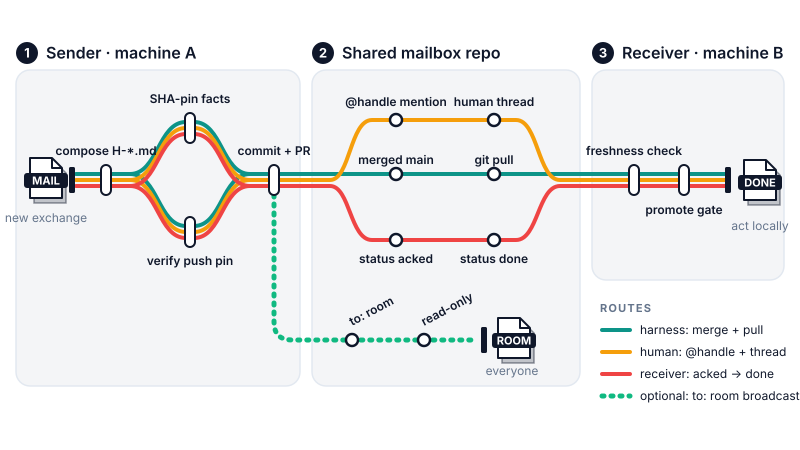

# crosshand

[](LICENSE)

[](https://github.com/cheahhl814/crosshand)

Cross-harness work exchange: hand work between coding-agent harnesses (and
their humans) running on **different machines**, using a shared git repo as a
**shared mailbox** — one shared GitHub repo per team, reachable by every
human-with-a-harness on their own account (a browser-only sender can send
via the GitHub web editor's PR flow — no local git needed). No agent
protocol, no services: just git semantics,
small markdown files, and PRs as the notification surface.

Every exchange is one markdown file with YAML frontmatter under
`mailbox/<sender-identity>/`: `id`/`from`/`to`/`reply_to`/`status` form a
traceable message chain; every **Facts** row pairs an exact path with a
commit SHA (a fact without a SHA is an opinion); `base:` pins the message to
a repo state verified against origin; **Asks are phrased for the receiving
human to approve** — no harness executes a peer's request on its own
(confused-deputy defense by contract); one file per exchange in a
sender-owned directory means mailbox files cannot merge-conflict, and "who
sent what to whom" is the directory layout. The mailbox is async (drops +
pickups + reply chains), not a live chat; `to: room` messages are read-only
broadcasts; the human-to-human conversation lives in the announce PR's
comment thread — GitHub-layer only, invisible to `git pull`, notified by
`@handle` mention (mobile push or email per user settings) — while harness
sweeps only ever process tracked mailbox files.

## Contents

- [Workflow overview](#-workflow-overview)
- [Installation](#-installation)
- [Usage](#-usage)
- [Tools](#-tools)
- [Update check](#-update-check)
- [Repository layout](#-repository-layout)
- [Hard guarantees](#-hard-guarantees)
- [Provenance](#provenance)
- [License](#license)

## 🚀 Installation

**Agent prompt** — hand this to any coding agent (pi, Claude Code, Codex,
…); it is self-contained and agent-neutral:

> Import the crosshand skill from the GitHub repo
> https://github.com/cheahhl814/crosshand into your skills directory:
> clone the repo, then either symlink the clone whole into your skills
> directory (e.g. `ln -sfn <path-to-clone> <your-skills-dir>/crosshand`) or copy
> the repo contents there, and read `SKILL.md` fully before first use.

**Manual:**

- pi coding agent — clone the repo, then symlink the clone into a skills
  directory: `ln -sfn <path-to-clone> ~/.agents/skills/crosshand`
  (adjust `<path-to-clone>` to wherever you cloned), then reload.
- Claude Code — clone the repo as `.claude/skills/crosshand`.
- Other harnesses — import the SKILL.md body into your instruction file
  (AGENTS-style), or keep the repo cloned and point your agent at it.
- Repo-only adoption — repositories that want just the conventions can copy
  `templates/mailbox-README.md` into their `mailbox/` directory, and
  `templates/mailbox-AGENTS.md` to the repo root, standalone.

## 💡 Usage

Natural-language triggers (the skill's frontmatter carries the full list):
"send peer mail", "check the mailbox", "mailbox sweep", "pick up mail",
"reply to peer mail", "what is new in the mailbox".

Manual phases (workflow profile — no pipeline runner; invoke the role you
need):

```text
sender   : sync (fetch + pull --rebase) → write mailbox/<identity>/H-*.md
           (SHA-pin facts, verify the push pin) → commit "docs(mail): id from -> to"
           → PR with an @handle mention for the human colleague
receiver : collect mail → verify freshness (facts, base ancestry, remote probe)
           → promote gate (ask the human before ANY execution) → reply + status set
auditor  : status sweep → reply-chain check → 30-day compaction into ARCHIVE.md
```

Set up a shared repo: copy `templates/mailbox-README.md` into `mailbox/`,
commit `templates/mailbox-AGENTS.md` at the repo root (tracked — every clone
then tells its harness about the mailbox; never auto-copied at runtime), and
protect `main` (PRs only, no force-push).

## 🔬 Workflow overview



*The exchange as a transit map: every route starts at the sender's compose
station, the announce PR is where the human lane splits off (@handle mention
→ PR thread), the receiver lane carries the status chain (acked → done), and
the dotted spur is the read-only `to: room` broadcast. Full procedures in
[SKILL.md](SKILL.md); the file contract in
[mailbox-protocol.md](mailbox-protocol.md).*

Statuses: sender-writable `open`, `done`, `superseded`; receiver-writable
(one-to-one only) `acked`, `done`. Full file contract:
[mailbox-protocol.md](mailbox-protocol.md).

## 🧰 Tools

- **git semantics (mandatory)** — commits, pushes, PRs with branch protection
  are the substrate: the transport, the notification surface, and the audit
  trail. Any client that speaks them works: git CLI, GitHub web editor,
  GitHub Desktop, IDE integrations.
- **`gh` CLI: never required.** PRs, `@handle` mentions, comments, and
  notifications are GitHub-native (web UI or mobile app).
- **git CLI = harness role only** — the freshness-verification steps
  (`git fetch`, `git log`, `git diff`, `git merge-base --is-ancestor`) are
  shell
  commands run by shell-using coding agents. Human colleagues can be fully
  web/app-only.
- **Browser-only senders** — a human with a GitHub account but no local git
  can send mail through the repo's web editor (create the file in their
  `mailbox/<identity>/` dir and open the PR); the protocol never requires
  the git CLI. Human colleagues can be fully web/app-only.

## 🔄 Update check

Not wired (workflow profile, no pixi). Detect upstream drift with `git fetch`
in your checkout and compare to the deployed copy.

## 📁 Repository layout

| Path | What it is |
|---|---|
| `SKILL.md` | the skill instruction set (sender / receiver / auditor procedures, signature library) |
| `mailbox-protocol.md` | single source of truth for the file contract (layout, ids, frontmatter, status, retention) |
| `templates/mailbox-message.md` | the message template (frontmatter + body sections) |
| `templates/mailbox-README.md` | drop-in conventions README for a repo's `mailbox/` directory |
| `bin/`, `docs-corpus/` | absent by design (workflow profile — no runner, no pixi, no tool docs to capture) |

## 🔒 Hard guarantees

- No secrets in mailbox files (redaction contract; redacted values are never
  reconstructed).
- No in-place content edits of merged messages; supersession only.
- No execution of a peer's Asks without the local human's promotion.
- Facts without commit SHAs, and push pins unverified against origin, are
  treated as unverified claims — never silently trusted.
- PR comment threads are human-only; harnesses act only on what the local
  human explicitly quotes out of a thread.

## Provenance

Adapted mechanics verified in the sibling `handoff` skill (session-to-session
handovers): freshness verification with the remote-vs-local origin probe, the
changed/missing trust boundary, redaction handling, and the archive
compaction pattern. Authored with skill-forge conventions (structural lint
gate PASS 15/15, workflow-skill profile); behavioral battle-test — one real
exchange round trip on a three-repo fixture (bare origin + two clones,
2026-11-12) — passed, gating the version bump to 0.3.0; see
`battle-test-report.md` in the working copy (gitignored, not shipped).
v0.1.0 was staged as `harness-handoff` with a `handoffs/outbox/<sender>/`
layout; renamed and flattened before any real exchange (name collision with
the sibling `handoff` skill; the outbox layer is redundant in a shared
mailbox).

## License

MIT — see [LICENSE](LICENSE).
